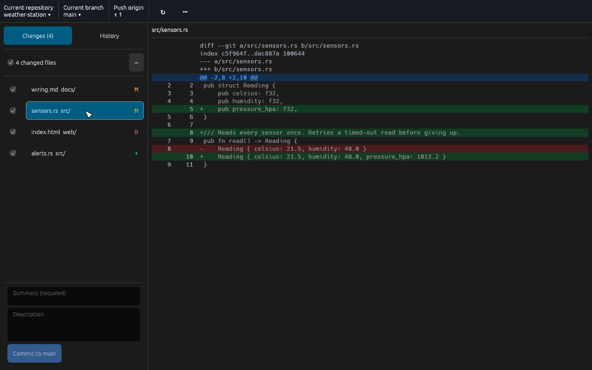
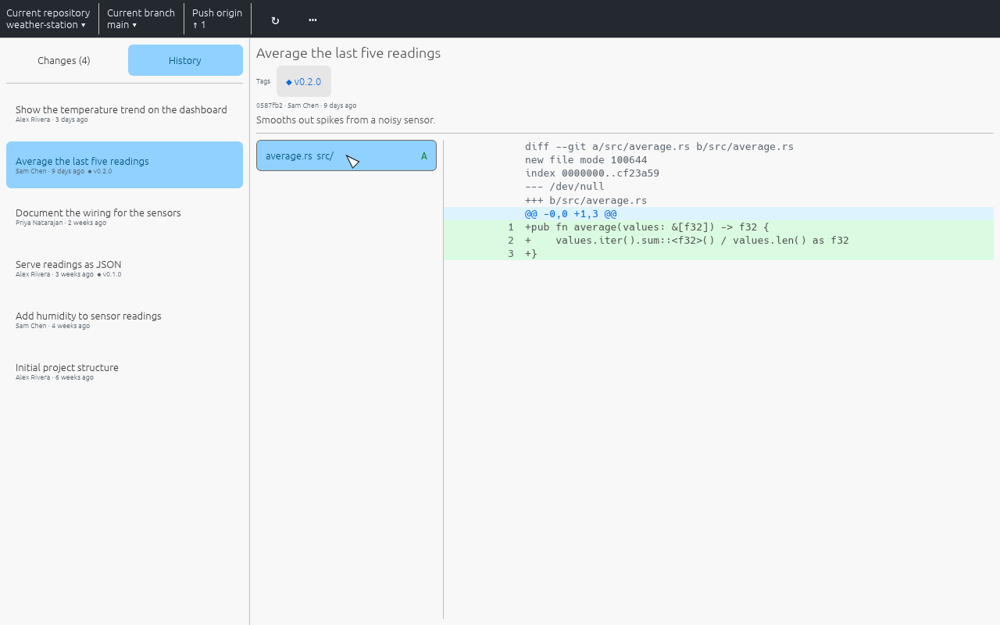
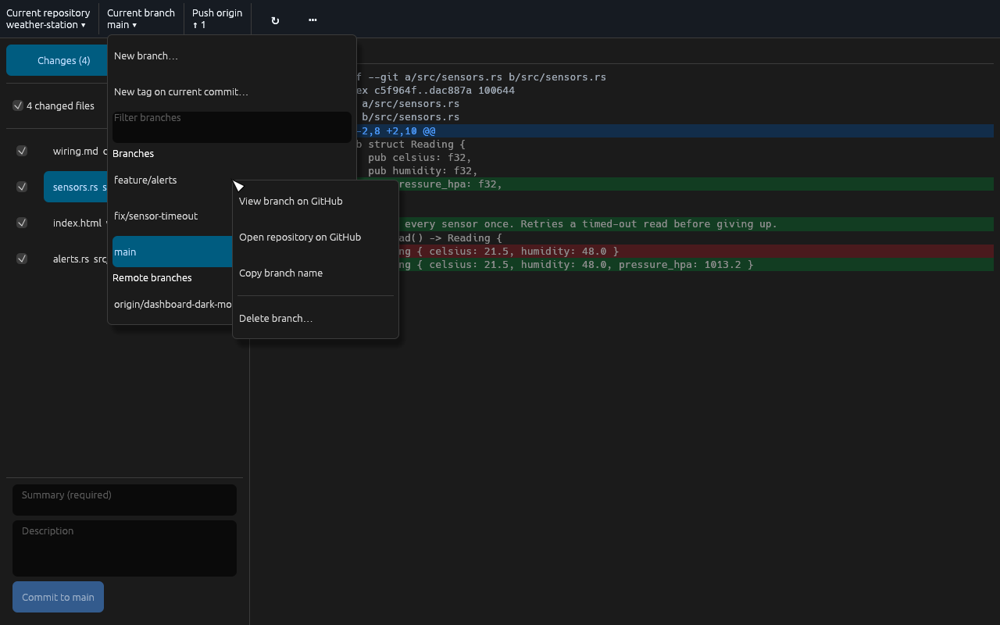
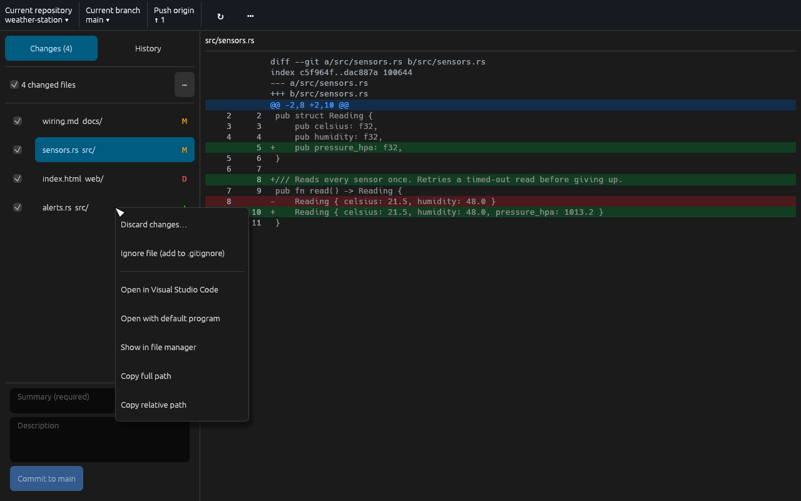
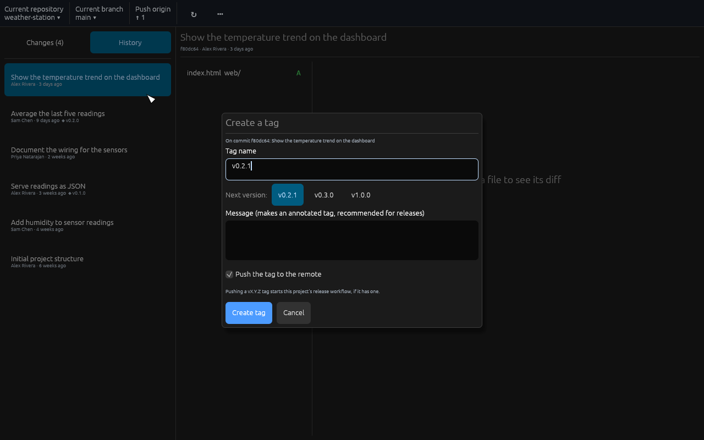
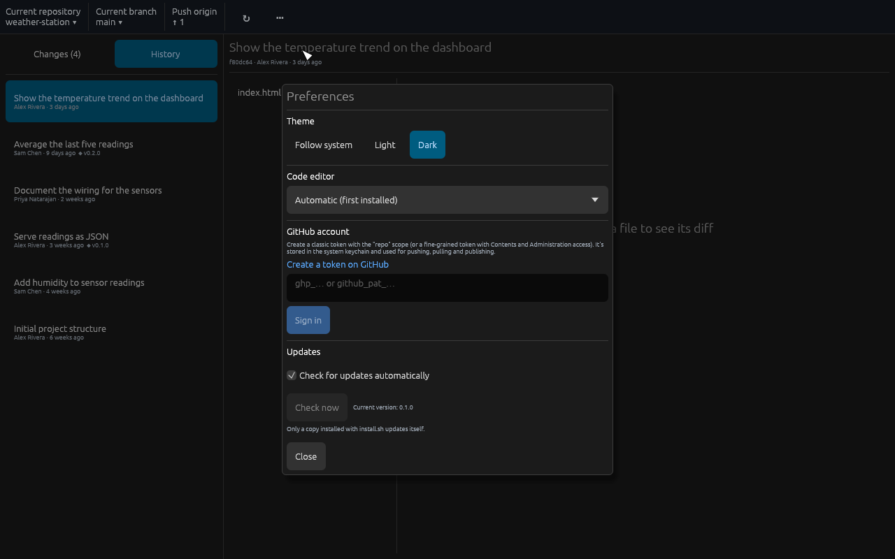
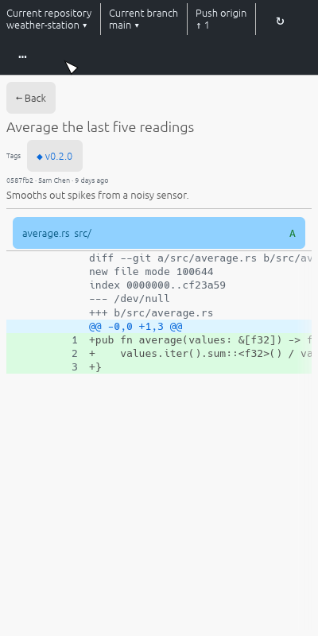

# GitHub Desktop Linux Enhanced

A GitHub Desktop style git client for Linux, written in Rust. It started because the unofficial
GitHub Desktop port for Linux has a bug where the window shrinks a little on every launch until it
can't be opened at all. This app is a native rewrite that fixes that, with first-class Linux support
(Wayland and X11), and it will add a pull request view so you can create and comment on PRs without
opening the browser.

It is not affiliated with GitHub. It uses your installed `git`, so your config, hooks, credential
helper and SSH keys work as they do in the terminal.

<p align="center">
  
</p>

## Screenshots

All screenshots use a made-up project, generated by `tests/readme_screenshots.rs`.

| | |
|---|---|
|  |  |
| History with release tags (light theme) | Right-click a branch to open it on GitHub |
|  |  |
| Right-click a file to open it in your editor | Tag a release with the next version suggested |
|  |  |
| Preferences: editor, GitHub account, updates | Works down to a 360 px wide window |

## Features

Available now:

- **Repositories**: add an existing local repository, clone one (full URL, SSH address or the
  `owner/repo` shorthand), create a new one, switch between them, and remove them from the list.
  Clone and create remember the last folder you used.
- **Changes**: see every changed file with a coloured diff, choose which files go into the commit
  with checkboxes, and commit with a summary and description.
- **Right-click menus like GitHub Desktop's**: open a repository or file in your code editor, show it
  in the file manager, open a file with its default program, copy paths, discard changes, or add a
  new file to `.gitignore`. Branches can be opened on GitHub, commits tagged or have their SHA
  copied. Right-click works on touchpads that also send a left click.
- **Your choice of editor**: the first installed editor is used automatically (VS Code, VSCodium,
  Cursor, Zed, Sublime Text, JetBrains IDEs, Kate, GNOME Text Editor and more), or pick one, or set
  any command in **Menu → Preferences**.
- **Discard**: throw away the changes to one file or to all of them, after confirming.
- **Stash**: stash all changes (including new files), restore a stash, or discard it.
- **History**: browse the last 500 commits on the current branch, with their tags, files and diffs.
- **Branches**: switch, filter, create (names are cleaned up the way GitHub Desktop does) and delete
  local branches, and check out remote branches.
- **Sync**: one button that publishes, pulls, pushes or fetches depending on the branch, with an
  ahead/behind count. A new branch is published to the remote with one click.
- **Publish repository**: put a local repository on GitHub (public or private) in one step, or
  connect any existing remote URL and push.
- **Tags for releases**: create a tag on the current commit (branch menu) or any commit (right-click
  in History). The dialog suggests the next patch, minor and major version after your highest
  `vX.Y.Z` tag, can make an annotated tag with release notes, and pushes it so a release workflow
  can start. Tags can be pushed or deleted later from the commit view.
- **Sign in to GitHub** with a personal access token, kept in the system keychain. Pushing, pulling
  and publishing then never ask for credentials. Without signing in, git's prompts (HTTPS username
  and password, SSH key passphrase, unknown host key) appear as dialogs in the app.
- **Updates**: the app checks GitHub releases on start and every 12 hours, downloads the new version
  in the background and offers **Install**, then **Restart now** or **Later**.
- **Light, dark and system themes**, a layout that works from a narrow 360 px window up to a wide
  screen, keyboard shortcuts, and screen reader labels.
- **A window that can't get lost**: sizes are only saved when the window is visible and in a normal
  state, and every saved size is checked again before use. See [Window size](#window-size).

Planned:

- **Pull requests**: list the open PRs on the repository, create a PR from the current branch, and
  read and write comments.
- Conflict resolution helpers, partial (line-by-line) commits, and amend/undo last commit.

## Install

### From a release

Download `github-desktop-enhanced-<version>-linux-x86_64.tar.gz` from the
[releases page](https://github.com/dansecan25/GithubDesktopLinuxEnhanced/releases), then:

```sh
tar -xzf github-desktop-enhanced-*-linux-x86_64.tar.gz
cd github-desktop-enhanced-*-linux-x86_64
./install.sh               # installs to ~/.local, no sudo
./install.sh --uninstall   # removes it again (keeps your settings)
```

### From source

You need Rust 1.95 or newer ([rustup](https://rustup.rs)) and `git` 2.23 or newer.

```sh
git clone https://github.com/dansecan25/GithubDesktopLinuxEnhanced.git
cd GithubDesktopLinuxEnhanced
cargo run --release
```

`./release.sh` runs the checks and tests, builds in release mode, and puts an installable package in
`dist/`.

## Usage

Start it from your app menu or run `github-desktop-enhanced`.

### Signing in to GitHub

GitHub doesn't accept account passwords for git, so the app signs in with a personal access token:

1. Open **Menu (⋯) → Preferences**, and follow **Create a token on GitHub**.
2. Create a classic token with the **repo** scope (or a fine-grained token with *Contents* and
   *Administration* read and write access, for the repositories you want to use).
3. Paste it into **Personal access token** and click **Sign in**.

The token is stored in your system keychain (GNOME Keyring or KWallet), never in the settings file.
Signing out removes it. Your own git setup keeps working too: a
[credential helper](https://git-scm.com/doc/credential-helpers) or an `ssh-agent` key is used
first, and anything git still needs to ask is shown as a dialog.

### Releasing with tags

To release a new version of a project: open the branch menu and choose **New tag on current
commit…** (or right-click a commit in History and choose **Create tag…**), pick the suggested next
version, write the release notes as the message, keep **Push the tag to the remote** ticked, and
click **Create tag**. In this repository, pushing a `vX.Y.Z` tag starts the release workflow, which
builds the package and creates a draft release to review and publish.

### Updates

The app checks [Releases](https://github.com/dansecan25/GithubDesktopLinuxEnhanced/releases) when
it starts and every 12 hours, and downloads the package for your system in the background. When it's
ready, a bar offers **Install**, then **Restart now**, or **Later** to keep working and use the new
version next time. Turn this off, or check right away, in **Menu → Preferences**. Only a copy
installed with `install.sh` updates itself, not one run from a source checkout. To update by hand,
download a newer package and run its `install.sh`. Settings and the saved token are kept either way.

### Keyboard shortcuts

| Shortcut | Action |
|---|---|
| Ctrl+Enter | Commit |
| Ctrl+1 / Ctrl+2 | Changes / History tab |
| F5 | Refresh |
| Ctrl+P | Push |
| Ctrl+Shift+P | Pull |
| Ctrl+Shift+T | Fetch |
| Ctrl+Shift+N | New branch |
| Ctrl+N | New repository |
| Ctrl+O | Add existing repository |
| Ctrl+Shift+O | Clone repository |
| Ctrl+Shift+A | Open the repository in your editor |
| Ctrl+Shift+F | Show the repository in the file manager |

### Window size

If the window ever opens at a size you don't want, start it once with:

```sh
github-desktop-enhanced --reset-window
```

The app menu entry also has an **Open with default window size** action. Settings are stored in
`~/.config/github-desktop-enhanced/settings.json`.

### If the app freezes or uses too much memory

The app can't take your whole computer down with it:

- It runs with a 2 GB memory limit, set through systemd, that also covers the git commands it
  starts. Editors and the file manager opened from the app run outside that limit.
  `GDE_MEMORY_CAP=off github-desktop-enhanced` starts it without the limit.
- If it goes over 1.5 GB, it saves a report and closes itself, and tells you on the next start.
- If the window stops responding for 5 seconds, it saves a report of what it was doing and which git
  commands were running.
- Git output is capped (diffs at 2 MB, other commands at 64 MB), and local git commands are stopped
  after 5 minutes. Clone, fetch, pull, push and commit have no time limit.

Reports are saved in `~/.local/state/github-desktop-enhanced/reports/`. They don't contain tokens,
file contents or commit messages.

## Development

```sh
./limited.sh cargo test                     # unit tests and git integration tests
./limited.sh cargo clippy --all-targets     # lints
cargo fmt                                   # formatting
GDE_SCREENSHOT_DIR=/tmp/shots ./limited.sh cargo test --test ui_screens -- --ignored   # renders the screens to PNG
GDE_README_SCREENSHOTS=docs/screenshots ./limited.sh cargo test --test readme_screenshots -- --ignored   # refreshes the README images
```

`limited.sh` runs a command with a memory limit (40% of RAM by default) and half the CPU cores, so
a heavy build or the software-rendered screenshot tests get stopped instead of freezing the desktop.
`LIMIT_MEMORY`, `LIMIT_SWAP` and `LIMIT_JOBS` change the limits. Run `./limited.sh` alone for help.

How the code is organised is described in [DOCUMENTATION.md](DOCUMENTATION.md). Project rules and
known issues are in [CONTEXT.md](CONTEXT.md).
